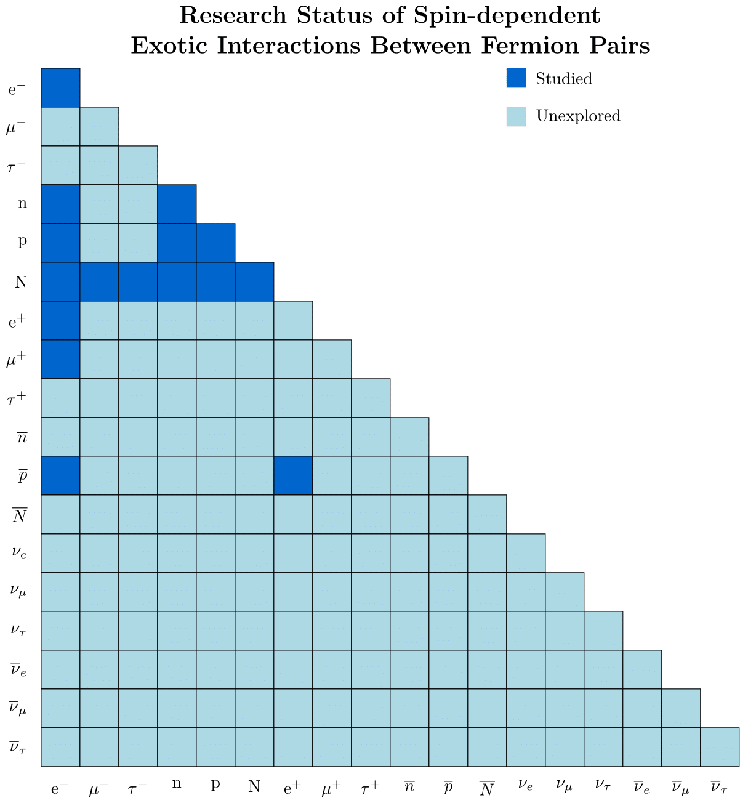

 #Fermion Pairs

<figure style="text-align:center;">
  
  <figcaption>
  <b>Figure 3:</b> Studied and unexplored fermion pairs.</figcaption>
</figure>

<aside class="fermion-history-note">
  A historical note
  <h2>How fermions got their name</h2>
  

    On 25 October 1926, Enrico Fermi wrote to Paul Dirac about their closely
    related work on quantum statistics—an exchange connected with what later
    became known as Fermi–Dirac statistics. In 1945, Dirac introduced the term
    <em>fermion</em> for particles obeying this statistics, naming them in
    Fermi’s honour.
  

  <a href="https://www.linkedin.com/posts/physicsarchives_100-years-ago-today-on-25-october-1926-activity-7520088058344525824-zNCO"
     target="_blank"
     rel="noopener">
    Read the story from Physics Archives ↗
  </a>
</aside>